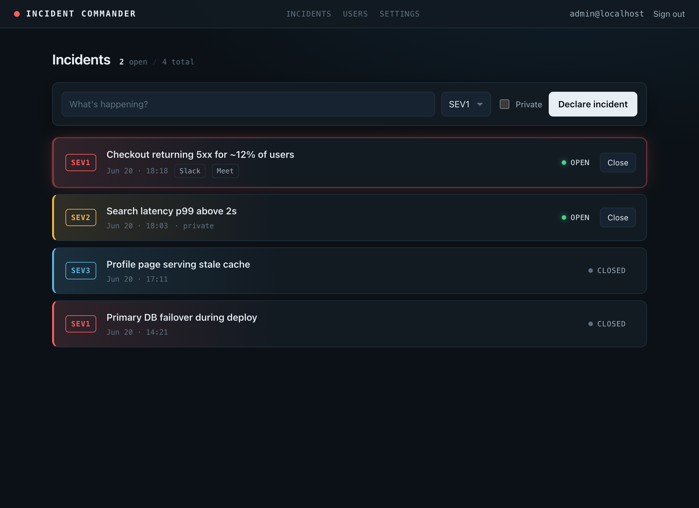

# Incident Commander

Open-source, self-hosted incident management. Declare an incident in one click and — once
configured — it opens a Slack channel and a video bridge, captures a timeline of everything that
happens, tracks roles, follow-ups and custom fields, and gives you a calm place to run the
response. Built to run on your own infrastructure, behind your own SSO.

[](https://github.com/giammbo/incident-commander/actions/workflows/ci.yml)
[](LICENSE)
[](pyproject.toml)



> **Status — production-shaped and running today.** Local auth + RBAC + generic OIDC SSO, the full
> configurable incident lifecycle (severities, statuses, types, roles, timeline, follow-ups, custom
> fields), **postmortems**, **insights/analytics**, **stakeholder updates**, **inbound alerting**
> (AWS CloudWatch/SNS, Prometheus Alertmanager, generic webhook), an **automation/workflow engine**
> (trigger → conditions → actions), **on-call & paging** (schedules, escalation paths, alert routing,
> email / Slack / SMS / voice / push), a systems/components catalogue with team ownership and a live 3D
> dependency map, and the optional Slack / Google Meet / outgoing-webhook / SMTP integrations are all in place.

## Features

### Incidents

- **Declaration to response** — title, severity, type, public/private, affected system + components, and a **Markdown description**. The chosen **type pre-fills the default severity** and the applicable custom fields. Required fields are checked before creation; success opens the incident detail. Search and status/severity/system filters help narrow the board.
- **Configurable lifecycle statuses** — define your own workflow (e.g. Triage → Investigating → Identified → Monitoring → Closed); each status carries a category (`triage` / `active` / `closed`) so "is it still open?" logic just works. Reopening is supported.
- **Configurable severities** — your own levels (`SEV1–SEV3`, `P1–P4`, …) with labels, **colours**, and order.
- **Configurable incident types** — Outage / Degraded / Maintenance / Security … each optionally driving a default severity.
- **Roles & assignees** — admin-defined role types (Incident Lead, Communications, Scribe, …); assign one or more people per role on an incident. A private incident is visible only to active admins, its active creator and active users explicitly assigned an incident role, including Read-only assignees. A general Incident Commander role does not grant private access. The same visibility applies to linked alerts, follow-ups, postmortems/exports, metrics and map overlays; unavailable records return 404.
- **Timeline** — an automatic chronological log (opened, status change, reopened, closed, role change, Slack/video added) plus **Markdown notes** you can pin.
- **Follow-ups / action items** — create, assign (with a due date), and complete/cancel/reopen action items per incident. The global **Follow-ups** page supports editing title, description, owner and due date with status filters. Closing an incident leaves follow-ups open and brings postmortem/follow-up actions forward; reopening is explicit.
- **Custom fields** — admin-defined fields (text, long text, single/multi-select, number, checkbox, date), scoped per incident type, shown on the declare form (type-dependent) and the detail.
- **Stakeholder updates** — post a Markdown broadcast (optionally with a status change) that lands on the timeline, posts to the incident's Slack channel, and fires the outgoing webhooks with an `update` event.
- **Postmortems** — a single Markdown document per incident, pre-assembled from the timeline + follow-ups, then editable. If the incident had a Google Meet, the Gemini-generated notes are pulled in automatically (after the call) as a **"Meeting notes (Gemini)"** section — Gemini smart notes and transcription are on by default for every incident Meet (requires the Google Meet API + Gemini for Workspace).

### Insights

- **Dashboard + breakdowns** — incident counts and severity/type/status/system/team breakdowns use the selected creation cohort (30d / 90d / all). **MTTR** averages creation-to-closure time for currently closed cohort incidents with valid timestamps, with its sample size shown; reopened incidents are excluded. Current open-incident and open-follow-up backlog is shown separately across all dates. Team attribution uses the system’s current owner. All results follow the signed-in user’s incident visibility.

### Inbound alerting

- **Ingest alerts** from your monitoring into a deduplicated **Alerts inbox** via a token-authenticated endpoint, then promote an alert to a new incident or attach it to an existing one.
- **Adapters** — **AWS SNS** (CloudWatch alarms natively + EventBridge-via-SNS best-effort, with AWS **signature verification**), **Prometheus Alertmanager** (the kube-prometheus webhook), and a **generic JSON** mapper. Alerts dedupe per source key and track a firing↔resolved lifecycle.
- **Generic JSON mapping** — each Generic JSON integration has a *Field mapping* form in **Settings → Inbound integrations**. Every field is a dotted path into the request body (`alert.id` reads `{"alert": {"id": "…"}}`):

  | Field | Required | Meaning |
  |---|---|---|
  | Dedup key path | yes | Unique alert key; repeats of the same key update one alert. Until it is set, ingest answers `400`. |
  | Title path | no | Alert title (defaults to `Alert`). |
  | Severity path | no | Raw severity, matched by alert automation conditions. |
  | Status path | no | Field holding the alert state; when absent the alert is `firing`. |
  | Resolved value | no | Value of the status field that marks the alert resolved (default `resolved`). |

  ```bash
  curl -X POST "$BASE_URL/ingest/<token>" -H 'Content-Type: application/json' \
    -d '{"alert": {"id": "chk-42", "name": "Checkout 5xx", "level": "critical", "state": "open"}}'
  ```

### Automation / workflows

- **Trigger → conditions → actions rules** (admin-defined) that run automatically on `incident.opened`, `incident.status_changed`, and `alert.received`. Conditions are AND-matched equalities on a fixed field set (severity / type / privacy / system for incidents; source / severity / status for alerts).
- **No IDs to know** — the editor is picker-driven: choose a trigger ("When an alert is received"), and only the conditions and actions that trigger supports are offered; condition values come from your real severities, types, systems and alert statuses ("is" or multi-select "is one of"), with a checkbox for privacy and free text only for the alert's source / raw severity. Each saved rule is listed as one readable sentence, e.g. *When an alert is received and severity is critical → create incident (SEV1)*.
- **Actions** reuse the app's own side-effects: open a Slack channel, assign a role, set status, post a stakeholder update, create a follow-up — and, for inbound alerts, **auto-create an incident** (linking the alert, recording which rule created it, running the incident-opened rules and firing the `opened` webhooks). Execution is inline, partial-failure-safe, and recorded on the timeline.
- **One path, same effects** — an incident declared from the form, promoted from the Alerts inbox, or auto-created by a rule gets the same treatment: incident-opened rules run and the `opened` webhooks fire.
- **Maintain and inspect** — edit rules without changing their IDs, disable/re-enable them, and test conditions against a sample without executing actions or sending notifications. Rules require a complete action. The list shows the latest matching execution time and a bounded outcome summary (success/partial failure/failure); previews do not overwrite that outcome. This records the latest matching run rather than a full execution history.

### Catalogue & map

- **Systems & Components** — register the Systems you operate and their Components (each in exactly one System), with a two-tier dependency graph (Component→Component within a system, System→System across systems). Dependencies are edited from a checklist that shows each item's direction and who uses it; **dependency loops are rejected** (direct or indirect), and choices that would close one are disabled with the reason.
- **Team ownership** — define **Teams** and assign an owning team to each system/component; shown on the catalogue and on the incident detail (who to pull in).
- **3D service map** — an interactive force-graph of systems/components with **live blast-radius** and an equivalent accessible list of states, directed relationships and catalog/incident links. Search, fit/reset, refresh status and retry are available; the list remains usable when the graph cannot load. Incidents naming components affect those selected components; whole-system incidents affect the system’s components. Dependent nodes show inferred impact, using only incidents visible to the signed-in user.

### Integrations *(all optional, partial-failure-safe)*

- **On-call paging** — see [On-call](#on-call).
- **Slack** — connect workspaces via OAuth; declaring an incident auto-opens a channel and posts opened/updated/closed messages.
- **Video** — pluggable video providers (Google Meet bridge auto-created per incident) via a small provider abstraction.
- **Outgoing webhooks** — fire on opened/updated/closed/update to **Slack, Microsoft Teams (Workflows / Adaptive Card), Discord, or a generic JSON** endpoint (`opened` fires however the incident was created: form, Alerts inbox, or alert automation). Delivered in the background (never slows the request), retried on network errors / 5xx, and optionally **HMAC-signed** — see [Outgoing webhooks](#outgoing-webhooks).
- **Inbound alerting** — receive alerts from AWS SNS (CloudWatch), Prometheus Alertmanager, or any system via a generic JSON endpoint (see [Inbound alerting](#inbound-alerting) above).

### Platform

- **Self-hosted, one command up** — FastAPI + HTMX from a single container + Postgres, via Docker Compose.
- **Auth & RBAC** — local accounts (argon2) **and** generic **OIDC SSO** (Azure Entra / Okta / Google / any OIDC IdP) with domain gating and a local break-glass. Three group-based roles: Admin, Incident Commander, Read-only.
- **User & group management** — admin UI to invite users (email when SMTP is set, or a generated temp password), resend/revoke invitations, reset access and deactivate/reactivate accounts. Failed email delivery preserves earlier valid recovery links and current credentials. Invites default to Read-only; local break-glass admin access is protected. Manage user group membership and edit groups in place.
- **Encrypted settings** — every integration credential/token is encrypted at rest (Fernet); secrets are never rendered in the UI or written to logs.
- **The UI** — a dark interface with **Flamingo** primary actions, semantic severity colours and sanitized Markdown (`nh3`). Navigation is grouped into Response, Learn, Catalog and Admin, with a compact mobile menu, labelled actions and keyboard focus. Browser access/missing-page/validation errors offer safe recovery links. Correctable form errors preserve nonsecret drafts in the response; passwords and credentials are not stored as browser drafts. JSON clients and signed callbacks retain their response protocols.

All integrations are partial-failure-safe: an incident is always created as a record, integrations run only when configured and applicable (Slack requires selecting a connection per incident; Google Meet uses the globally-configured service account), and a failing integration is surfaced on the incident — never a 500.

## Quick start (Docker Compose)

Requires Docker.

```bash
git clone https://github.com/giammbo/incident-commander.git
cd incident-commander
cp .env.example .env
```

Generate the two required secrets and put them in `.env`:

```bash
# SESSION_SECRET
python -c "import secrets; print(secrets.token_urlsafe(48))"
# FERNET_KEYS
python -c "from cryptography.fernet import Fernet; print(Fernet.generate_key().decode())"
```

Then bring it up:

```bash
docker compose up --build
```

Open <http://localhost:8000>. The **bootstrap admin password is printed once in the app logs**
on first start — log in as `IC_ADMIN_EMAIL` (default `admin@localhost`). The first login asks you
for a new password and your display name.

```bash
docker compose logs app | grep "Generated password"
```

## Upgrading

Alembic migrations run automatically on application startup. This update includes
`0020_automation_outcomes` after `0019_oncall`, adding nullable latest-execution fields to workflow
rules. Existing rules show no recorded outcome until their next actual run. Apply the normal database
backup and rollout procedure before upgrading.

## Configuration

Bootstrap secrets live in the environment (`.env`). Everything else — Slack / Google / SMTP / **OIDC SSO**
credentials, and shared catalogue definitions (**severities, statuses, incident types, roles, custom
fields and teams**) — is configured at runtime from the admin **Settings** page (secrets stored
encrypted in the database). Systems and components are maintained from their Catalog navigation pages.

Settings has section links and configuration readiness feedback. Edit severities, statuses, incident
types, role types, custom fields, teams, groups, webhooks and automations in place to preserve IDs and
references. Destructive actions explain their impact; referenced/default catalog records are guarded.
Webhook disable/re-enable avoids deleting a destination. Leaving an existing credential field blank
keeps the saved secret. Configuration saves perform structural checks (URLs, JSON keys, required
credentials and supported templates); they do not establish provider connectivity. Webhook preview
builds a local sample without delivery, while SMTP test is an explicit send action. Readiness and
local previews do not prove successful provider delivery.

| Variable | Purpose | Required | Default |
|---|---|---|---|
| `DATABASE_URL` | Postgres connection (`postgresql+psycopg://…`) | yes | built from `POSTGRES_*` in Compose |
| `SESSION_SECRET` | Signs the session cookie | yes | — (generate it) |
| `FERNET_KEYS` | Comma-separated Fernet keys for encrypting secrets at rest (first encrypts; the rest enable rotation) | yes | — (generate it) |
| `BASE_URL` | Public base URL (used for OAuth/OIDC redirects) | yes | `http://localhost:8000` |
| `IC_ADMIN_EMAIL` | Email of the bootstrap admin | no | `admin@localhost` |
| `SESSION_HTTPS_ONLY` | Mark the session cookie `Secure` — **set `true` in production behind HTTPS** | no | `true` (Compose ships `false` for localhost) |
| `POSTGRES_USER` / `POSTGRES_PASSWORD` / `POSTGRES_DB` | Compose Postgres credentials | no | `ic` / `ic` / `incident_commander` |

> `FERNET_KEY` (singular) is accepted as a convenience alias for a single `FERNET_KEYS` value.

### Single sign-on (OIDC)

Works with any OpenID Connect provider (Azure Entra ID, Okta, Google, Auth0, Keycloak, …). In your IdP,
create an application and register the redirect URI `<BASE_URL>/auth/oidc/callback`. Then in
**Settings → Single sign-on (OIDC)** set the **Issuer URL**, **Client ID**, **Client secret**, an optional
button label, and the **allowed email domains** (empty = trust any user from that issuer); tick *Enable SSO*.
A local-password break-glass remains available so an admin can always sign in. Accounts are matched by the
issuer + subject claim (no silent account takeover). The sign-in button requires enabled SSO plus
an issuer, client ID and client secret. A safe local deep link is retained through login, required
password change and SSO; expired or consumed invitation links show recovery guidance.

### Google Meet (video bridge)

Meets are created via the **Google Meet API** under a **service account with Domain-Wide Delegation
(DWD)** that impersonates a fixed Workspace user. No per-user OAuth or Calendar events are involved.

1. In **Google Cloud Console** (<https://console.cloud.google.com>), enable the **Google Meet API**
   and the **Google Drive API**.
2. Create a **service account**; create and download a **JSON key**. No project IAM roles are
   needed. Note its numeric **client ID**.
3. In **Workspace Admin Console → Security → API controls → Domain-wide delegation**, authorize that
   client ID for the scopes `https://www.googleapis.com/auth/meetings.space.created` and
   `https://www.googleapis.com/auth/drive.readonly`.
4. In **Settings → Google**, paste the **JSON key** and an **impersonation user** email — a
   Workspace user with a **Gemini for Workspace** license. Incidents' Meets are created as this
   user, and its Drive receives the Gemini notes. Tick *Enabled*, save.

Incident Meets are created via the Meet API with **Gemini smart notes and transcription on by
default**. No Calendar event is created. Requires a Workspace edition with the Gemini add-on.

(Slack is analogous: create an app at <https://api.slack.com/apps>, register
`<BASE_URL>/connections/slack/callback`, paste the credentials into **Settings → Slack**, then connect a workspace.)

### Outgoing webhooks

Add them in **Settings → Outgoing webhooks**. Deliveries leave the request on a small background
pool: the page responds immediately, and each webhook gets 1 attempt + 2 retries (0.5 s, then 1.5 s
backoff) on network errors or HTTP 5xx; 4xx responses are not retried. A failing webhook never
blocks the others or the incident operation. Pending deliveries live in memory only.

- **Microsoft Teams** — the legacy Office 365 connectors (`MessageCard`) are retired. In Teams, add a
  **Workflows** webhook (*"Post to a channel when a webhook request is received"*) and paste its URL.
  The payload is `{"type":"message","attachments":[{"contentType":"application/vnd.microsoft.card.adaptive","content":{…}}]}`
  with an Adaptive Card 1.4: title, severity / status facts, the stakeholder message (for `update`)
  and an *Open incident* button.
- **Signature** — set an optional **signing secret** (stored encrypted, write-only). Each request
  then carries `X-IC-Signature: sha256=<hex>`, the HMAC-SHA256 of the raw request body keyed with
  the secret. Verify it against the bytes you received, before parsing the JSON:

  ```python
  import hashlib, hmac

  def verify(secret: str, body: bytes, header: str) -> bool:
      expected = "sha256=" + hmac.new(secret.encode(), body, hashlib.sha256).hexdigest()
      return hmac.compare_digest(expected, header or "")
  ```

## On-call

Page the right person when an alert fires, and keep escalating until somebody acknowledges.
Everything lives under **On-call** in the sidebar (admins and Incident Commanders edit; Read-only users see it).

**Concepts and flow**

- **Schedule** — who is on call, built from *rotations* (people in order, shift length, handoff time, optional day/hour windows) in an IANA time zone; DST-safe. Higher rotations win, lower ones fill the gaps. **Overrides** replace a shift for a period, and anyone can *Take this shift* for themselves.
- **Escalation path** — an ordered list of **levels**. A level targets one or more schedules and/or specific people and has an *acknowledge timeout*. If nobody acknowledges within it, the next level starts; after the last level (and optional repeats) the escalation is marked **exhausted** (still open — it can be acknowledged or resolved).
- **Route** — alert → path rules (*if integration / source / severity / title matches → page this path*). The first matching enabled route wins; when *high if* conditions are set, the route's own urgency is ignored: alerts matching them page as high, the rest as low. Alerts that fail to page show a "paging failed" chip in the inbox.
- **Escalation** — one page. Status goes `triggered → acknowledged → resolved` (plus `exhausted`). A repeated alert with the same key does not open a second escalation, and a **resolved** alert from the source closes it automatically.
- **Urgency** — `high` or `low`. Inactive conditional urgency fields do not block saves; routes can be simulated against a sample without creating a page or sending notifications. Current and future rotation versions show separate effective dates in the schedule’s time zone. Each person sets per-urgency notification rules in **Account → Notifications** (default: email and Slack immediately; for high also SMS after 2 min and a phone call after 5 min). Contact methods (phone numbers need verification), browser-push subscriptions and a *send me a test* button live on the same page.
- **Manual paging** — **On-call → Page** (or *Page* from an incident): choose a path or specific people, an urgency and a message; optionally attach it to an incident (it lands on the timeline). Paging does not grant private-incident access: assign an incident role first. Ineligible recipients are excluded, with access checked again before delivery and acknowledgement. An escalation can also be turned into an incident (*Declare incident*).
- **Acknowledge** from the web UI, from the signed link in any notification (`/oncall/ack/<token>` shows a confirm page; the POST acknowledges), by pressing 1 on the call, by replying `ACK <code>` to the SMS, or with the Slack button. Once acknowledged, no further notification is sent.

**Channels** (each is optional and partial-failure-safe: a channel that fails records a `failed` status with the reason and never blocks the others or the escalation)

| Channel | Setup |
|---|---|
| Email | Configure SMTP in **Settings → SMTP**; sent to the user's account email. |
| Slack | A DM (with Acknowledge/Escalate buttons) to the user, matched by email. In your Slack app set **Interactivity → Request URL** to `{BASE_URL}/slack/interactions` and add the bot scopes `chat:write`, `channels:manage`, `groups:write`, `im:write`, `users:read`, `users:read.email`. The Slack **signing secret** must be saved in **Settings → Slack**. Workspaces connected before this release must be **reinstalled** (Add to Slack) to grant the new scopes. |
| SMS / voice | **Settings → On-call**: Twilio Account SID, auth token and From number. In the Twilio console, set the number's *A message comes in* webhook to `{BASE_URL}/oncall/twilio/sms` (HTTP POST). Voice callbacks (`/oncall/twilio/voice/{eid}/{uid}`, `/oncall/twilio/gather/{eid}/{uid}`) are passed per call by the app, so nothing to configure; `BASE_URL` must be publicly reachable by Twilio, and requests are verified with the Twilio signature. |
| Browser push | **Settings → On-call → Generate push keys** (VAPID, stored encrypted), then each user subscribes from **Account → Notifications**. Setup reports progress, denied permission and failures, with a worker at root scope. Requires HTTPS (or localhost). |

A verified phone remains active while a replacement awaits verification. A failed send, wrong code or
expired challenge does not remove the existing verified contact.

Public inbound endpoints (they authenticate by signed token / provider signature, not by session): `GET/POST /oncall/ack/{token}`, `POST /slack/interactions`, `POST /oncall/twilio/voice/{eid}/{uid}`, `POST /oncall/twilio/gather/{eid}/{uid}`, `POST /oncall/twilio/sms`.

### On-call worker

Escalation timers, retries and notifications are driven by a small worker loop (a tick every ~5 s). By default it runs **in-process**, as a thread of the web server (`ONCALL_WORKER_IN_PROCESS=true`) — nothing to deploy. It is multi-worker safe (rows are claimed with `SKIP LOCKED`), so a rolling restart never double-sends.

To run it as its own process (isolates paging from web restarts):

- **Docker Compose** — uncomment the `worker` service in `docker-compose.yml` (it runs `docker/entrypoint.sh worker`) **and** set `ONCALL_WORKER_IN_PROCESS: "false"` on `app`.
- **Helm** — `--set oncall.worker.separate=true` adds a `worker` Deployment and turns the in-process thread off in the app pods. Keep `oncall.worker.replicaCount` at 1–2.

**If the worker is not running, nobody is paged.** Every tick records a heartbeat; when it is older than 120 s the UI shows a banner ("The on-call worker is not running") and `/healthz` reports it — it always answers `200`, so a stale worker never restarts the web pod by itself:

```json
{"status": "ok", "oncall_worker": "ok"}
```

| `oncall_worker` | Meaning |
|---|---|
| `ok` | last tick under 120 s ago |
| `stale` | last tick older than 120 s — **page-affecting, alert on this** |
| `never` | no tick ever recorded (fresh install, or the worker was never started) |
| `unknown` | the heartbeat could not be read |

## Deploy on Kubernetes (Helm)

Released images and the chart are published to GHCR on each `vX.Y.Z` tag.

The chart requires an **external Postgres** — it does not bundle a database.

```bash
# 1) Create the app secret (SESSION_SECRET + FERNET_KEYS — never commit real values)
kubectl create secret generic ic-secrets \
  --from-literal=SESSION_SECRET="$(python -c 'import secrets;print(secrets.token_urlsafe(48))')" \
  --from-literal=FERNET_KEYS="$(python -c 'from cryptography.fernet import Fernet;print(Fernet.generate_key().decode())')"

# 2) Create the DB secret (holding the Postgres password)
kubectl create secret generic ic-db-secret \
  --from-literal=password=<your-postgres-password>

# 3) Install
helm install ic oci://ghcr.io/giammbo/charts/incident-commander --version <X.Y.Z> \
  --set secrets.existingSecret=ic-secrets \
  --set externalDatabase.host=<pg-host> \
  --set externalDatabase.existingSecret=ic-db-secret \
  --set config.baseUrl=https://incident.example.com \
  --set ingress.enabled=true --set ingress.host=incident.example.com
```

The bootstrap admin password is printed once in the pod logs:

```bash
kubectl logs deploy/ic-incident-commander | grep "Generated password"
```

## Development

```bash
uv sync                 # install deps (Python 3.12)
cp .env.example .env     # fill SESSION_SECRET and FERNET_KEYS
uv run pytest            # run the test suite — Docker required (testcontainers spins up Postgres)
uv run ruff check .      # lint
uv run ruff format .     # format
```

See [CONTRIBUTING.md](CONTRIBUTING.md) for the full contributor guide.

## Architecture

A single server-rendered FastAPI service: Jinja2 templates with HTMX (no JavaScript build step),
sync SQLAlchemy 2.0 + psycopg3 against Postgres, Alembic migrations applied on startup. Configurable
catalogues (severities, statuses, types, roles, custom fields, teams) follow one consistent pattern;
the timeline auto-captures lifecycle events; integrations (Slack, video providers, outgoing webhooks)
sit behind small abstractions and are partial-failure-safe. Secrets are encrypted at rest with Fernet;
bootstrap secrets come from the environment. Markdown is rendered with `markdown` and sanitized with `nh3`.

## Roadmap

- **Core platform** — local auth + group RBAC, generic OIDC SSO, SMTP email invites ✅
- **Integrations** — Slack channels, Google Meet bridge (via a video-provider abstraction), outgoing webhooks (Slack/Teams/Discord/generic) ✅
- **Incident process** — configurable severities, statuses (with categories), incident types, roles & assignees, timeline (auto events + notes), follow-ups / action items, custom fields, stakeholder updates, postmortems ✅
- **Catalogue** — systems & components with a two-tier dependency graph, team ownership, and a live 3D blast-radius map ✅
- **Insights & alerting** — insights/analytics (MTTR, breakdowns, trends) and inbound alerting (AWS CloudWatch/SNS, Prometheus Alertmanager, generic) into an Alerts inbox with promotion to incidents ✅
- **Automation** — a trigger → conditions → actions workflow engine (incident-opened / status-changed / alert-received), with alert→incident auto-creation ✅
- **On-call & paging** — schedules and overrides, multi-level escalation paths, alert→path routing, manual paging, notifications over email / Slack / SMS / voice / browser push with acknowledge and auto-resolve ✅
- **Next** — public status page, a native Slack/Teams bot, and a public API.

## Security

Integration credentials and tokens are encrypted at rest (Fernet), passwords are hashed with
argon2, and sessions use a signed `SameSite=Lax` cookie. State-changing requests are protected
against **CSRF** by an Origin/Referer check (the inbound `/ingest` endpoint is exempt — it is
authenticated by its own secret token). Please report vulnerabilities privately — see
[SECURITY.md](SECURITY.md). Run behind HTTPS with `SESSION_HTTPS_ONLY=true` in production.

**Behind a reverse proxy:** set `BASE_URL` to the public origin **and** forward the original `Host`
header, so the CSRF check's allowed-origin set matches the browser's real origin. For the public
`/ingest` endpoint, also consider a proxy-level rate limit (the app caps each request body at 256 KB).

## Contributing

Contributions are welcome — see [CONTRIBUTING.md](CONTRIBUTING.md) and our
[Code of Conduct](CODE_OF_CONDUCT.md).

## License

Apache License 2.0 — see [LICENSE](LICENSE) and [NOTICE](NOTICE).

Dependencies are permissively licensed (MIT / BSD / Apache-2.0), with one exception: the Postgres
driver [`psycopg`](https://www.psycopg.org/) is LGPL-3.0. It is used as an unmodified, separately
installed library, which is compatible with shipping this project under Apache-2.0; its LGPL notice
is retained.
